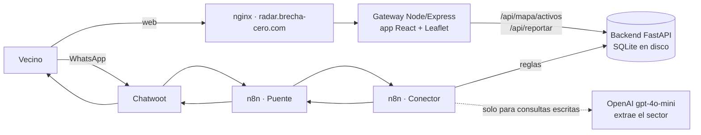

# Radar 📡 · cortes de luz reportados por los vecinos

[](https://github.com/DanMen-Dev/valencia-luz-core/actions/workflows/pruebas.yml)

**Mapa en vivo:** https://radar.brecha-cero.com/mapa

Radar es un mapa comunitario de cortes de luz en Venezuela. Los vecinos reportan desde la web o por WhatsApp ("no hay luz aquí" / "ya volvió"), el mapa muestra los reportes de las últimas 12 horas y un bot responde cómo está un sector con datos reales: desde qué hora no hay luz, cuánto han durado los cortes de la semana y, si hay datos suficientes, una hora estimada de retorno.

> *English summary:* community-sourced power-outage map for Venezuela. FastAPI + SQLite backend, React + TypeScript map (Vite, react-leaflet) served by a Node/Express gateway, and an n8n WhatsApp flow that routes messages with rules and uses a single LLM call (zone extraction). Self-hosted with Docker Compose behind nginx on a Hetzner VPS.

## Estado

| Parte | Estado |
|---|---|
| Mapa web y reporte desde el navegador | En producción |
| Backend (API, estimaciones, respaldo diario) | En producción, 27 pruebas automáticas |
| Bot de WhatsApp (n8n + Chatwoot) | Probado de punta a punta con eventos simulados; falta conectar un número de WhatsApp |
| Frontend en React + TypeScript (Vite) | En producción |

No es información oficial de Corpoelec: todo sale de lo que reportan los vecinos.

## Cómo funciona



**Por WhatsApp**

1. El vecino envía su **ubicación**. El backend la guarda como pendiente y el bot le pide el nombre del sector (tiene 10 minutos).
2. Responde **"Prebo"** (sin luz) o **"Si, Prebo"** (volvió la luz). El backend completa el reporte; el estado se lee del texto con reglas, no con IA.
3. Si escribe una **consulta** ("¿cómo está la luz en Tocuyito?"), un único llamado al modelo extrae el sector y el backend devuelve el mensaje ya redactado con datos reales.

Saludos, ubicaciones y respuestas de sector se resuelven con reglas en un nodo de código; el modelo solo interviene en consultas libres. Antes el flujo usaba tres llamados (clasificar, extraer y redactar) y el redactor inventaba horas cuando faltaban datos.

**Por la web**

La app de React tiene dos botones ("No hay luz donde estoy" / "Ya volvió la luz donde estoy") que usan la ubicación del navegador. El reporte toma el nombre del sector reportado más cercano (a 1,5 km o menos). El mapa se actualiza cada minuto.

### Qué calcula el backend (y qué no)

Para cada sector, con los reportes de los últimos 7 días:

- **Corte:** un episodio que empieza con un reporte "sin luz" y termina con el primer "volvió la luz" posterior.
- **Duración promedio:** el promedio de los cortes que sí terminaron.
- **Retorno estimado:** inicio del corte de hoy + duración promedio. **Solo se da si hay cortes medidos**; si no, el bot lo dice.
- **Probabilidad de corte:** días con al menos un corte ÷ 7.

Es estadística simple y transparente, no un modelo predictivo. Un modelo de verdad necesita más historia de la que hay hoy.

## Decisiones y lecciones

- **La base de datos vivía dentro del contenedor.** Un `docker compose up --build` la habría borrado, y el respaldo nocturno apuntaba a un archivo que no existía. Ahora vive en `./datos` (volumen) y el respaldo usa la API de backup de SQLite.
- **El estado de la conversación estaba en memoria** y se perdía con cada reinicio. Pasó a una tabla, con vencimiento.
- **Un nombre de sector podía inyectar HTML en el mapa.** Los popups ahora son componentes de React, que escapan el texto; además hay CSP y otras cabeceras de seguridad.
- **Campos que no coincidían entre n8n y el backend** (`nombre_zona` vs `zona`, `tiene_luz` vs `estado_luz`). El backend acepta ambos, y el estado sale del texto: n8n buscaba "si" en cualquier parte y "Casiano" contaba como "con luz".
- **nginx compartido con otro proyecto:** `/static/` lo tomaba Django y devolvía 400. El subdominio tiene ahora su propio bloque.
- **Puertos cerrados al público:** n8n y el gateway escuchan solo en `127.0.0.1`; el puente llama al Conector por `localhost`. Los secretos van en credenciales de n8n o en `.env`, nunca en el repo.
- **Topes contra abuso:** 6 reportes por hora por teléfono y 10 por hora por conexión en la web; coordenadas fuera de Venezuela se rechazan.

## Stack

Python 3.13 · FastAPI · SQLite · React 19 · TypeScript · Vite · react-leaflet · Node 24 · Express · n8n · Chatwoot · OpenAI (gpt-4o-mini) · Docker Compose · nginx · Let's Encrypt · GitHub Actions · VPS en Hetzner.

## Estructura

```
main.py                  API FastAPI: reportes, conversación, resumen por sector, mapa
tests/                   pruebas con pytest (base temporal, hora fija)
frontend/                app React + TypeScript (Vite): panel, mapa, hook de reportes, cliente de la API
GatewayNode/             gateway Express: sirve la app compilada y hace de puente hacia el backend
n8n/                     flujos exportados (Conector y Puente) y probar_conector.sh
docker-compose.yml       backend, gateway y n8n
backup_db.sh             respaldo diario de la base (cron), guarda 7 días
seed_data.py             datos falsos para desarrollo; no correr en producción
```

## Correrlo

```bash
docker compose up -d --build
# mapa:     http://127.0.0.1:5050/mapa
# backend:  docker exec luz_backend_python python -c "import urllib.request;print(urllib.request.urlopen('http://localhost:8000/api/salud').read().decode())"
```

Frontend en modo desarrollo (con el gateway corriendo en Docker):

```bash
cd frontend && npm ci && npm run dev   # http://localhost:5173/recursos/
```

Pruebas del backend:

```bash
pip install -r requirements-dev.txt
pytest -q
```

Prueba del bot sin WhatsApp (envía eventos simulados al Conector y borra sus reportes al final):

```bash
bash n8n/probar_conector.sh
```

### Configuración (`.env`)

| Variable | Para qué | Por defecto |
|---|---|---|
| `VL_WHATSAPP` | Número del bot para el botón del mapa (solo dígitos); vacío lo oculta | vacío |
| `VL_DB_PATH` | Ruta de la base SQLite | `/app/datos/valencia_luz_persistente.db` |
| `VL_HORAS_MAPA` | Horas que un reporte se ve en el mapa | 12 |
| `VL_REPORTES_POR_HORA` | Tope por teléfono | 6 |
| `VL_MINUTOS_ESPERA_NOMBRE` | Tiempo para responder el sector | 10 |
| `VL_REPORTES_WEB_POR_HORA` | Tope de reportes web por conexión | 10 |

Los nombres internos (`valencia_luz`, `luz_backend_python`, el repo) vienen del nombre anterior del proyecto y se mantienen para no romper la base ni los flujos.

## Próximos pasos

- Conectar un número de WhatsApp al bot.
- Agrupar reportes cercanos del mismo sector en el mapa.
- Pruebas del frontend (Vitest + Testing Library).
- Más historia → estimaciones por franja horaria.

---

Hecho por **Daniel Mendoza** ([DanMen-Dev](https://github.com/DanMen-Dev)), con ayuda de Claude en la revisión y los parches.
