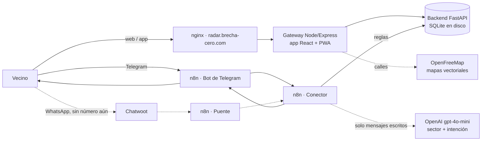

# Radar 📡 · cortes de luz reportados por los vecinos

[](https://github.com/DanMen-Dev/valencia-luz-core/actions/workflows/pruebas.yml)

**Mapa en vivo:** https://radar.brecha-cero.com/mapa · **Bot:** [@RadarCortesBot](https://t.me/RadarCortesBot) en Telegram

Radar es un mapa comunitario de cortes de luz en Venezuela. Los vecinos avisan cuando se va la luz y cuando vuelve; el mapa muestra los cortes activos sector por sector, y el bot responde cómo está un sector con datos reales: desde qué hora no hay luz, cuánto suelen durar los cortes ahí, a qué hora suelen empezar y, si hay datos, una hora estimada de retorno. Es gratis, no pide registro y no guarda datos personales.

Se empezó a compartir en noviembre de 2026 en grupos de vecinos.

> *English summary:* community-sourced power-outage map for Venezuela, in production. FastAPI + SQLite backend (cells-and-aliases geodata model, typo-tolerant sector search, outage episodes and hour/weekday patterns), React 19 + TypeScript PWA (Vite, react-leaflet, MapLibre over free OpenFreeMap vector tiles, offline map), Node/Express gateway, and a channel-agnostic n8n chat bot (Telegram, free; WhatsApp-ready) that routes with rules and makes a single LLM call. 150 automated tests in GitHub Actions. Self-hosted with Docker Compose behind nginx on a Hetzner VPS. Cost per user: effectively zero.

## Cómo lo usa un vecino

| Dónde | Qué hace |
|---|---|
| **Mapa** ([radar.brecha-cero.com](https://radar.brecha-cero.com/mapa)) | "No hay luz donde estoy" / "Ya volvió la luz donde estoy" con un toque (usa la ubicación del teléfono). En cada círculo puede confirmar con **"Yo también"** o avisar **"Aquí ya volvió"**. |
| **Telegram** ([@RadarCortesBot](https://t.me/RadarCortesBot)) | Botón "📍 Enviar mi ubicación" y el nombre del sector; o escribir "se fue la luz en Prebo", "ya volvió la luz en Prebo" o "¿hay luz en Tocuyito?". |
| **App en el teléfono** | Se instala desde el mapa (en iPhone, desde Safari) y abre con los últimos reportes aunque no haya señal. |
| **Compartir** | Botón "Compartir el mapa por WhatsApp": manda el enlace a los grupos, sin costo para el proyecto. |

No es información oficial de Corpoelec: todo sale de lo que reportan los vecinos.

## Estado

| Parte | Estado |
|---|---|
| Mapa web (React + TypeScript, PWA, sin conexión) | En producción · 57 pruebas (Vitest + Testing Library) |
| Backend (reportes, celdas, búsqueda, estimaciones, patrones, contador) | En producción · 93 pruebas (pytest) |
| Bot de Telegram (n8n) | En producción, gratis |
| Canal de WhatsApp (n8n + Chatwoot) | Listo, sin número conectado: en WhatsApp cada respuesta del bot se cobra |
| Panel privado de estadísticas | En producción (`/estadisticas`, con clave) |
| Respaldo diario y recálculo nocturno de cortes | En producción (cron) |

## Arquitectura



**El bot no sabe de canales.** Cada canal (Telegram, WhatsApp) tiene un flujo pequeño que traduce sus mensajes al mismo formato y devuelve la respuesta; el **Conector** decide con reglas:

1. **Ubicación** → el backend la guarda como pendiente y el bot pide el nombre del sector (10 minutos para responder).
2. **Respuesta de sector** → "Prebo" (sin luz) o "Si, Prebo" (volvió). El estado sale del texto con reglas, no con IA.
3. **Mensaje escrito** → una única llamada al modelo extrae el sector y sugiere la intención; el backend decide con reglas que mandan sobre el modelo (una pregunta nunca es un reporte):
   - **consulta** ("¿cómo está la luz en Tocuyito?"): resumen con datos reales;
   - **aviso** ("mira, se fue la luz en Tocuyito"): si el sector ya está en el mapa, queda reportado en el centro de su celda y el bot confirma; si no, pide la ubicación.

Saludos y ubicaciones nunca pasan por el modelo. El flujo original hacía tres llamadas (clasificar, extraer, redactar) y el redactor inventaba horas cuando faltaban datos; ahora el texto lo arma el backend.

## El modelo de datos

| Tabla | Qué guarda |
|---|---|
| `circuitos` | Cada **reporte** (nombre heredado del proyecto original): teléfono o id, coordenadas, sector, con o sin luz, hora, origen (`whatsapp`, `web`, `confirmacion`, `texto`) y **celda**. Nunca se borra: es la base para predecir. |
| `celdas` | Cuadros fijos de 0,01° (~1,1 km × 1,1 km). El id sale de las coordenadas redondeadas hacia abajo (`10.21_-68.02`): el mismo lugar da siempre la misma celda. |
| `alias` | **Nombres populares con votos por celda.** Cada vez que un vecino manda su ubicación y escribe su sector, ese nombre suma un voto en su celda. Así "Prebo", "Urb. Prebo" y "Prevo" quedan amarrados al mismo lugar. |
| `cortes` | Cortes ya calculados por celda (inicio, fin, duración, tipo), recalculados cada noche. |
| `actividad` | Contador de vecinos: día, canal y una huella cifrada (HMAC), nunca el teléfono. |
| `conversaciones` | "Esperando el nombre del sector", con vencimiento (sobrevive a reinicios). |

Con las celdas y los alias:

- en el mapa, una variante minoritaria ("prevo") se ve con el nombre más votado de su celda; un sector de borde con 30 % o más de los votos conserva el suyo;
- un reporte desde la web toma el nombre de su celda o de sus vecinas;
- el resumen de un sector suma todas las celdas que cubre su nombre;
- **búsqueda tolerante:** se busca el nombre tal cual, luego como variante amarrada ("prevo" → Prebo) y luego con errores de letra (distancia de Damerau-Levenshtein: 1 error en nombres de 5 a 8 letras, 2 en los largos, ninguno en los cortos): "Tocuyto" → Tocuyito, "sandiego" → San Diego. El bot dice qué entendió, y si dos sectores quedan igual de parecidos pregunta "¿te refieres a Prado o Pardo?" en vez de adivinar.

## Qué calcula (y qué no)

- **Corte:** empieza con un "sin luz" y termina con el primer "volvió" posterior.
- **Vencimiento (6 h):** un corte sin noticias (ni un "sin luz" nuevo ni un "volvió") se da por terminado a las 6 horas, el promedio general, y sale del mapa. Un "volvió" antes lo cierra; un "sin luz" después abre otro ciclo. Los cortes vencidos no entran en los promedios: no se sabe cuánto duraron.
- **Retorno estimado:** inicio del corte de hoy + duración promedio del sector; sin cortes medidos, el promedio general, dicho así: "aprox. 6:00 PM (promedio general de 6 h)". Nunca una hora sin explicar de dónde sale.
- **Patrones (predicción, etapa 1):** con las últimas 8 semanas, a qué hora suelen empezar los cortes (franjas de 3 horas), qué días se repiten, cuánto duran (mediana) y en qué porcentaje de los días hubo corte en la franja de ahora. Solo con al menos 4 cortes en 2 semanas, y con la evidencia a la vista: "Patrón (8 cortes en 4 semanas): los cortes suelen empezar entre las 12 PM y 3 PM (martes y jueves), duran unas 4 h."

Es estadística simple y transparente, a propósito: con pocos datos, un modelo más complejo solo aprendería ruido. La tabla `cortes` es la base para la **etapa 2** (un modelo de probabilidad) cuando haya meses de historia.

## Decisiones y lecciones

- **Telegram en vez de WhatsApp para el bot.** En la API de WhatsApp las respuestas del bot se cobran por mensaje: con 10 reportes al mes serían unos $0,20 por usuario. Los bots de Telegram son gratis: el costo bajó unas 400 veces. WhatsApp se usa para difundir el enlace, que no cuesta nada.
- **OpenFreeMap en vez de MapTiler.** El plan gratis de MapTiler se pausa al pasar 5.000 sesiones al mes, justo lo que pasaría en un apagón grande. OpenFreeMap no tiene límite ni clave; si falla, el mapa vuelve solo a las imágenes de OpenStreetMap.
- **PWA porque en un apagón también cae la señal.** El service worker guarda la app, la última lista de reportes y las calles ya vistas. MapLibre (~300 KB) se carga aparte: la app y los círculos aparecen primero.
- **Celdas y alias en vez de nombres de texto libre.** Con texto libre, "Prebo" y "Prevo" eran dos sectores y las estadísticas se partían.
- **Un solo modelo y reglas que mandan.** Más barato, más predecible y probado: el modelo extrae, el backend decide.
- **La base de datos vivía dentro del contenedor.** Un `docker compose up --build` la habría borrado y el respaldo apuntaba a un archivo que no existía. Ahora vive en `./datos` y el respaldo usa la API de backup de SQLite.
- **Un nombre de sector podía inyectar HTML en el mapa.** Los popups son componentes de React, que escapan el texto; además hay CSP y otras cabeceras de seguridad.
- **nginx compartido con otro proyecto:** `/static/` lo tomaba Django y devolvía 400. El subdominio tiene su propio bloque.
- **Privacidad:** el contador usa un número al azar del navegador y huellas HMAC; el panel privado recibe la clave en una cabecera, no en la URL. n8n y el gateway escuchan solo en `127.0.0.1`; los secretos van en credenciales de n8n o en `.env`.
- **Topes contra abuso:** 6 reportes por hora por teléfono, 10 por conexión en la web; coordenadas fuera de Venezuela, rechazadas.

## Costo

Por usuario al mes, prácticamente **$0**: el bot de Telegram, el mapa y OpenFreeMap son gratis, y los reportes se resuelven con reglas. El modelo solo interviene en mensajes escritos (~$0,00005 cada uno). El único costo real es el VPS.

## Stack

Python 3.13 · FastAPI · SQLite · React 19 · TypeScript · Vite · react-leaflet · MapLibre · OpenFreeMap · PWA (service worker) · Vitest · Testing Library · pytest · Node 24 · Express · n8n · OpenAI (gpt-4o-mini) · Telegram Bot API · Docker Compose · nginx · Let's Encrypt · GitHub Actions · VPS en Hetzner.

## Estructura

```
main.py                  API FastAPI: reportes, celdas y alias, búsqueda, estimaciones, patrones, contador
tests/                   pruebas del backend (pytest, base temporal)
frontend/                app React + TypeScript (Vite): panel, mapa, hooks, cliente de la API
frontend/public/         manifiesto, íconos y service worker (sw.js) de la PWA
GatewayNode/             gateway Express: sirve la app, puente hacia el backend, topes y CSP
GatewayNode/admin/       panel privado de estadísticas (/estadisticas)
n8n/                     flujos (Conector, bot de Telegram, puente de Chatwoot) y probar_conector.sh
docker-compose.yml       backend, gateway y n8n
backup_db.sh             respaldo diario de la base, guarda 7 días
seed_data.py             datos falsos para desarrollo; no correr en producción
```

**API del backend:** `POST /api/reportar/gps`, `/api/reportar/nombre`, `/api/reportar/texto`, `/api/reportar` (web), `/api/confirmar` ("yo también"), `/api/visita` · `GET /api/mapa/activos`, `/api/analitica/historico`, `/api/analitica/patrones`, `/api/sectores`, `/api/usuario/esperando-nombre`, `/api/contador`, `/api/estadisticas` (con clave), `/api/salud`.

## Correrlo

```bash
docker compose up -d --build
# mapa:     http://127.0.0.1:5050/mapa
# backend:  docker exec luz_backend_python python -c "import urllib.request;print(urllib.request.urlopen('http://localhost:8000/api/salud').read().decode())"
```

Frontend en modo desarrollo (con el gateway corriendo en Docker): `cd frontend && npm ci && npm run dev` → http://localhost:5173/recursos/

Pruebas:

```bash
pip install -r requirements-dev.txt && pytest -q        # backend
cd frontend && npm ci && npm test                        # frontend
bash n8n/probar_conector.sh                              # bot, con eventos simulados (borra sus datos al final)
```

Tareas programadas (cron del servidor):

```
0 0 * * *   /root/ValenciaLuz/backup_db.sh
10 3 * * *  docker exec luz_backend_python python main.py recalcular-cortes >> /var/log/radar_cortes.log 2>&1
```

### Configuración (`.env`)

| Variable | Para qué | Por defecto |
|---|---|---|
| `VL_HORAS_CORTE` | Un corte sin noticias vence (y sale del mapa) a estas horas; también es el promedio general para estimar | 6 |
| `VL_TELEGRAM` | Usuario del bot de Telegram para el botón del mapa (sin @) | `RadarCortesBot` |
| `VL_WHATSAPP` | Número del bot de WhatsApp para el botón del mapa (solo dígitos); vacío lo oculta | vacío |
| `VL_CLAVE_ESTADISTICAS` | Clave del panel privado `/estadisticas`; vacía lo desactiva | vacía |
| `VL_CONTADOR_MINIMO` | El contador "vecinos este mes" del mapa aparece desde este número | 50 |
| `VL_SECRETO_CONTADOR` | Llave de las huellas del contador; vacía, se crea una al azar junto a la base | vacía |
| `VL_REPORTES_POR_HORA` | Tope de reportes por teléfono | 6 |
| `VL_REPORTES_WEB_POR_HORA` | Tope de reportes web por conexión | 10 |
| `VL_MINUTOS_ESPERA_NOMBRE` | Tiempo para responder el sector | 10 |
| `VL_DB_PATH` | Ruta de la base SQLite | `/app/datos/valencia_luz_persistente.db` |

Los nombres internos (`valencia_luz`, `luz_backend_python`, `circuitos`, el repo) vienen del nombre anterior del proyecto y se mantienen para no romper la base ni los flujos.

## Próximos pasos

- Reportes sin conexión que se envían solos al volver la señal, y avisos por sector con notificaciones web.
- Predicción, etapa 2: un modelo de probabilidad por celda cuando haya meses de historia.
- Despliegue automático desde GitHub Actions, `ruff` y `mypy` en Python, y una prueba de punta a punta con Playwright.
- Renombrar el repo y los servicios internos a `radar`.

---

Hecho por **Daniel Mendoza** ([DanMen-Dev](https://github.com/DanMen-Dev)), con ayuda de Claude en la revisión y los parches.
