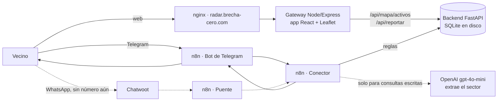

# Radar 📡 · cortes de luz reportados por los vecinos

[](https://github.com/DanMen-Dev/valencia-luz-core/actions/workflows/pruebas.yml)

**Mapa en vivo:** https://radar.brecha-cero.com/mapa

Radar es un mapa comunitario de cortes de luz en Venezuela. Los vecinos reportan desde la web o por un bot de Telegram ("no hay luz aquí" / "ya volvió"), el mapa muestra los cortes activos (un corte sin noticias vence a las 6 horas) y un bot responde cómo está un sector con datos reales: desde qué hora no hay luz, cuánto han durado los cortes de la semana y, si hay datos suficientes, una hora estimada de retorno.

> *English summary:* community-sourced power-outage map for Venezuela. FastAPI + SQLite backend, React + TypeScript map (Vite, react-leaflet) served by a Node/Express gateway, and an n8n chat bot (Telegram, free; WhatsApp-ready through the same channel-agnostic flow) that routes messages with rules and uses a single LLM call (zone extraction). Self-hosted with Docker Compose behind nginx on a Hetzner VPS.

## Estado

| Parte | Estado |
|---|---|
| Mapa web y reporte desde el navegador | En producción |
| Backend (API, estimaciones, respaldo diario) | En producción, 93 pruebas automáticas |
| Bot de Telegram [@RadarCortesBot](https://t.me/RadarCortesBot) (n8n) | En producción, gratis |
| Canal de WhatsApp (n8n + Chatwoot) | Listo, sin número conectado: los mensajes del bot se cobran por mensaje |
| Frontend en React + TypeScript (Vite) | En producción, 57 pruebas con Vitest y Testing Library |
| App instalable (PWA) y mapa sin conexión | En producción |

No es información oficial de Corpoelec: todo sale de lo que reportan los vecinos.

## Cómo funciona



**Por Telegram (o WhatsApp)**

El Conector de n8n no sabe de canales: cada canal tiene un flujo pequeño que traduce sus mensajes al mismo formato y devuelve la respuesta. Telegram es el canal principal porque sus bots son gratis; en WhatsApp cada respuesta del bot se cobra, así que ese canal queda listo pero apagado, y WhatsApp se usa para **difundir**: el botón "Compartir el mapa por WhatsApp" no le cuesta nada al proyecto.


1. El vecino envía su **ubicación** (en Telegram, con el botón "📍 Enviar mi ubicación"). El backend la guarda como pendiente y el bot le pide el nombre del sector (tiene 10 minutos).
2. Responde **"Prebo"** (sin luz) o **"Si, Prebo"** (volvió la luz). El backend completa el reporte; el estado se lee del texto con reglas, no con IA.
3. Si **escribe** algo, un único llamado al modelo extrae el sector y sugiere la intención; el backend decide con reglas (una pregunta nunca es un reporte):
   - **consulta** ("¿cómo está la luz en Tocuyito?"): responde el resumen con datos reales;
   - **aviso** ("mira, se fue la luz en Tocuyito" / "ya volvió la luz en Prebo"): si el sector ya es conocido, queda reportado en el centro de su celda más votada y el bot confirma; si no, pide la ubicación.

Saludos, ubicaciones y respuestas de sector se resuelven con reglas en un nodo de código; el modelo solo interviene en consultas libres. Antes el flujo usaba tres llamados (clasificar, extraer y redactar) y el redactor inventaba horas cuando faltaban datos.

**Por la web**

La app de React tiene dos botones ("No hay luz donde estoy" / "Ya volvió la luz donde estoy") que usan la ubicación del navegador. El reporte toma el nombre del sector reportado más cercano (a 1,5 km o menos). El mapa se actualiza cada minuto y agrupa los reportes cercanos del mismo sector en un solo círculo, con el número de vecinos y cuántos tienen o no luz.

**"Yo también":** en la ventanita de cada grupo, un toque confirma el corte ("Yo también estoy sin luz") o lo contradice ("Aquí ya volvió"), sin pedir ubicación. Solo suma a sectores que ya tienen reportes activos a menos de 2 km; no puede crear sectores nuevos, y comparte el tope por conexión con los reportes web.

### Celdas y nombres populares

El mapa está dividido en **celdas** fijas de 0,01° (unos 1,1 km × 1,1 km en Venezuela, el tamaño de un sector). Su id sale de las coordenadas redondeadas hacia abajo (`10.21_-68.02`), así que el mismo lugar da siempre la misma celda.

Cada vez que un vecino manda su ubicación y escribe su sector, ese nombre suma un **voto** en su celda (tabla `alias`). Así "Prebo", "Urb. Prebo" y "Prevo" quedan amarrados al mismo lugar, sin depender de cómo lo escriba cada uno:

- en el mapa, una variante minoritaria se muestra con el nombre más votado de su celda; un sector de borde con peso propio (30 % o más de los votos) conserva su nombre;
- un reporte desde la web toma el nombre de su celda o de sus vecinas;
- el resumen de un sector suma los reportes de todas las celdas que cubre su nombre.

**Búsqueda tolerante:** cuando alguien pregunta por un sector, el nombre se busca primero tal cual, después como variante amarrada a un sector ("prevo" → Prebo) y después con errores de letra (1 en nombres de 5 a 8 letras, 2 en los más largos, ninguno en los cortos): "Tocuyto" → Tocuyito, "sandiego" → San Diego. El bot dice qué entendió; si dos sectores quedan igual de parecidos, pregunta "¿te refieres a Prado o Pardo?" en vez de adivinar. Cada reporte con ubicación enseña variantes nuevas.

Los reportes se guardan para siempre (tabla `circuitos`, cada fila es un reporte con su celda): son la base para predecir.

### Qué calcula el backend (y qué no)

Para cada sector, con los reportes de los últimos 7 días:

- **Corte:** un episodio que empieza con un reporte "sin luz" y termina con el primer "volvió la luz" posterior.
- **Duración promedio:** el promedio de los cortes que sí terminaron.
- **Vencimiento:** un corte sin noticias (ni un "sin luz" nuevo ni un "volvió") se da por terminado a las 6 horas, el promedio general de un corte, y sale del mapa. Un "volvió la luz" antes lo cierra; un "sin luz" después abre otro ciclo. Los cortes vencidos no entran en los promedios porque no se sabe cuánto duraron.
- **Retorno estimado:** inicio del corte de hoy + duración promedio del sector. Si el sector aún no tiene cortes medidos, se usa el promedio general (6 h) y se dice así: "aprox. 6:00 PM (promedio general de 6 h)".
- **Probabilidad de corte:** días con al menos un corte ÷ 7.

**Patrones (predicción, etapa 1):** con las últimas 8 semanas de un sector, a qué hora suelen empezar los cortes (franjas de 3 horas), qué días se repiten, cuánto duran (mediana de los cortes medidos) y en qué porcentaje de los días hubo corte en la franja horaria de ahora. Solo se muestra con al menos 4 cortes en 2 semanas distintas, y el bot dice con cuántos datos lo calculó: "Patrón (8 cortes en 4 semanas): los cortes suelen empezar entre las 12 PM y 3 PM (martes y jueves), duran unas 4 h."

Cada noche se recalcula la tabla `cortes` (inicio, fin, duración y tipo de cada corte por celda), la base para la etapa 2: un modelo de probabilidad cuando haya varios meses de historia.

Es estadística simple y transparente, a propósito: con pocos datos, un modelo más complejo solo aprendería ruido.

### App instalable y mapa sin conexión

Durante un apagón muchas veces cae también la señal de datos, así que Radar es una **PWA**: en Android y en computadora se instala desde el botón "Instalar Radar"; en iPhone la app muestra los pasos (Safari → Compartir → Agregar a inicio) y abre sin conexión. Un service worker guarda la app, la última lista de reportes (el panel avisa "Sin conexión: mostrando los reportes guardados a las …") y las calles ya vistas.

El fondo del mapa es **OpenFreeMap**, estilo *Liberty* (mapas vectoriales a color con datos de OpenStreetMap, gratis, sin clave ni límite de vistas), dibujado con MapLibre debajo de las capas de Leaflet. MapLibre pesa unos 300 KB comprimido, así que se carga aparte: la app y los círculos aparecen primero sobre las imágenes de OpenStreetMap, y el fondo vectorial las reemplaza cuando termina de dibujarse. Si el teléfono no tiene WebGL o OpenFreeMap falla, se quedan las imágenes de OpenStreetMap. Se descartó MapTiler porque su plan gratis se pausa al pasar 5.000 sesiones al mes, justo lo que pasaría en un apagón grande.

### Contador de vecinos, sin datos personales

Radar cuenta vecinos únicos por día, semana y mes sin guardar nada que identifique a nadie: el mapa genera un número al azar en el navegador y avisa una vez al día; el bot guarda una huella cifrada (HMAC) del teléfono o del id de Telegram, nunca el número. El total del mes se muestra discreto al pie del panel cuando pasa de 50; el detalle (por canal, quiénes vuelven, sectores más activos) está en un panel privado en `/estadisticas`, protegido con una clave que viaja en una cabecera, no en la URL.

## Decisiones y lecciones

- **La base de datos vivía dentro del contenedor.** Un `docker compose up --build` la habría borrado, y el respaldo nocturno apuntaba a un archivo que no existía. Ahora vive en `./datos` (volumen) y el respaldo usa la API de backup de SQLite.
- **El estado de la conversación estaba en memoria** y se perdía con cada reinicio. Pasó a una tabla, con vencimiento.
- **Un nombre de sector podía inyectar HTML en el mapa.** Los popups ahora son componentes de React, que escapan el texto; además hay CSP y otras cabeceras de seguridad.
- **Campos que no coincidían entre n8n y el backend** (`nombre_zona` vs `zona`, `tiene_luz` vs `estado_luz`). El backend acepta ambos, y el estado sale del texto: n8n buscaba "si" en cualquier parte y "Casiano" contaba como "con luz".
- **nginx compartido con otro proyecto:** `/static/` lo tomaba Django y devolvía 400. El subdominio tiene ahora su propio bloque.
- **Puertos cerrados al público:** n8n y el gateway escuchan solo en `127.0.0.1`; el puente llama al Conector por `localhost`. Los secretos van en credenciales de n8n o en `.env`, nunca en el repo.
- **Topes contra abuso:** 6 reportes por hora por teléfono y 10 por hora por conexión en la web; coordenadas fuera de Venezuela se rechazan.

## Stack

Python 3.13 · FastAPI · SQLite · React 19 · TypeScript · Vite · react-leaflet · MapLibre · OpenFreeMap · PWA (service worker) · Node 24 · Express · n8n · Chatwoot · OpenAI (gpt-4o-mini) · Docker Compose · nginx · Let's Encrypt · GitHub Actions · VPS en Hetzner.

## Estructura

```
main.py                  API FastAPI: reportes, conversación, resumen por sector, mapa
tests/                   pruebas con pytest (base temporal, hora fija)
frontend/                app React + TypeScript (Vite): panel, mapa, hook de reportes, cliente de la API
GatewayNode/             gateway Express: sirve la app compilada y hace de puente hacia el backend
n8n/                     flujos exportados (Conector, bot de Telegram y puente de Chatwoot) y probar_conector.sh
docker-compose.yml       backend, gateway y n8n
backup_db.sh             respaldo diario de la base (cron), guarda 7 días
seed_data.py             datos falsos para desarrollo; no correr en producción
```

## Correrlo

```bash
docker compose up -d --build
# mapa:     http://127.0.0.1:5050/mapa
# backend:  docker exec luz_backend_python python -c "import urllib.request;print(urllib.request.urlopen('http://localhost:8000/api/salud').read().decode())"
```

Frontend en modo desarrollo (con el gateway corriendo en Docker):

```bash
cd frontend && npm ci && npm run dev   # http://localhost:5173/recursos/
```

Pruebas del frontend:

```bash
cd frontend && npm ci && npm test
```

Pruebas del backend:

```bash
pip install -r requirements-dev.txt
pytest -q
```

Prueba del bot sin WhatsApp (envía eventos simulados al Conector y borra sus reportes al final):

```bash
bash n8n/probar_conector.sh
```

### Configuración (`.env`)

| Variable | Para qué | Por defecto |
|---|---|---|
| `VL_CLAVE_ESTADISTICAS` | Clave del panel privado `/estadisticas`; vacía lo desactiva | vacía |
| `VL_CONTADOR_MINIMO` | El contador "vecinos este mes" del mapa aparece desde este número | 50 |
| `VL_TELEGRAM` | Usuario del bot de Telegram para el botón del mapa (sin @) | `RadarCortesBot` |
| `VL_WHATSAPP` | Número del bot para el botón del mapa (solo dígitos); vacío lo oculta | vacío |
| `VL_DB_PATH` | Ruta de la base SQLite | `/app/datos/valencia_luz_persistente.db` |
| `VL_HORAS_CORTE` | Un corte sin noticias vence (y sale del mapa) a estas horas; también es el promedio general para estimar | 6 |
| `VL_REPORTES_POR_HORA` | Tope por teléfono | 6 |
| `VL_MINUTOS_ESPERA_NOMBRE` | Tiempo para responder el sector | 10 |
| `VL_REPORTES_WEB_POR_HORA` | Tope de reportes web por conexión | 10 |

Los nombres internos (`valencia_luz`, `luz_backend_python`, el repo) vienen del nombre anterior del proyecto y se mantienen para no romper la base ni los flujos.

## Próximos pasos

- Reportes sin conexión que se envían solos al volver la señal, y avisos por sector con notificaciones web.
- Más historia → estimaciones por franja horaria.

---

Hecho por **Daniel Mendoza** ([DanMen-Dev](https://github.com/DanMen-Dev)), con ayuda de Claude en la revisión y los parches.
